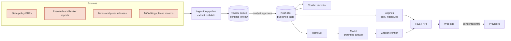

# Kosh architecture

## The job

A head-office team planning a first India centre has to choose a city, an operating model (EOR, BOT or own entity), a lease and a set of partners. The published numbers they use disagree, and most of the people publishing them also sell setup services. Kosh gives them one sourced record and a way to apply it to their own plan.

## System at a glance

## Data model

Everything hangs off two tables: `sources` and `facts`.

- **sources**: publisher, title, URL, date, kind, and `sells_services`, the interest to declare. 23 of the 48 seed sources sell GCC services in some form; Kosh still uses them and says so.
- **facts**: one figure as the source states it (`value_text`), a normalised number (`value_num`), unit, **definition** (companies vs units, which city set), `as_of`, `source_id`, and a review `status`. Only `published` facts are ever served.
- **conflicts / conflict_facts**: a question ("How many GCCs are in India?"), the facts that answer it differently, and a human explanation of why.
- **states**: policy status, the published incentives, and `rules_json`, the eligibility rules as data (minimum headcount, ownership, parent ranking, excluded functions, first-N limits). Policy text changes become data changes, not code changes.
- **providers / deliveries**: a provider's public claim is kept apart from deliveries Kosh has verified. A delivery becomes `verified` only with client confirmation plus a document (contract extract, MCA filing, lease record or client letter) and is shown only with the client's permission.
- **plans / intro_requests**: a user's plan and, only on explicit consent, a request to share it with named providers. Consent text and time are stored per provider.
- **audit_log**: every seed, ingestion and review decision.

Company and unit are separate concepts throughout. Most of the "how many GCCs" confusion is people comparing a company count with a centre count.

## Ingestion pipeline

1. **Collect.** Watch lists for state IT department sites, PIB, broker quarterly releases, research publishers and news; MCA filings bought per company (₹100 each) for parent confirmation; lease-registration data under licence. No LinkedIn or Naukri scraping: both prohibit it and LinkedIn litigates.
2. **Extract.** The model reads the document and returns JSON against a controlled list of metrics and subjects, with the exact supporting quote. Offline, a rule-based extractor does the same for common patterns.
3. **Validate.** Unknown subject or metric, non-numeric value, bad date or missing quote: rejected with reasons.
4. **Review.** Valid candidates land as `pending_review`. An analyst approves or rejects. Nothing the model extracts is ever shown before a person approves it.
5. **Reconcile.** On approval, the conflict detector compares the figure with published figures for the same subject and metric. A gap above 10% opens or extends a conflict, which needs a written explanation.

## AI layer

Three uses, each bounded:

| Use | Input | Output | Guardrail |
|---|---|---|---|
| Read my plan | Free text from the user | Structured plan JSON | Every field validated against allowed values; the user sees and edits the result |
| Ask Kosh | Question + retrieved facts + plan | Short answer with fact ids | Answers only from supplied facts; invented citations are stripped; "no verified figure" is a valid answer; never ranks providers |
| Brief summary | Computed comparison + facts | Two paragraphs | Same citation rules; the numbers come from the engines, not the model |
| Extraction (internal) | Source document | Candidate facts with quotes | Controlled vocabulary, validation, human review |

The engines (cost, incentives, conflicts) contain no AI. A board member can ask "where does ₹8.2 crore come from" and get a formula and three sources.

In the hosted prototype the model is reached through the Claude artifact runtime on the viewer's own account. Self-hosted, `frontend/shim.js` routes the same calls to `/api/sample`, which uses the server's API key.

## Cost model

Year-one run cost = payroll + office + EOR fees (when the plan uses an EOR).

- Payroll: year-1 headcount × city software-engineer median × 1.125 (statutory load, midpoint of the 10–15% vendor range).
- Office: headcount × 100 sq ft × rent × 12. City rent where Kosh has a sourced figure; otherwise the tier-1 vendor range. Tier-2 cities without data are not priced.
- EOR: US$99–599 per person per month, the low and high published vendor prices.
- Not included and stated on screen: fit-out, IT, recruitment fees, travel, BOT fees (unpublished).

The output is always a range. A wide range is information: it says the inputs are uncertain.

## Incentive screening

Each state's rules are data. The screen returns *Likely eligible*, *Check first*, *Not eligible* or *No policy yet*, with plain-language reasons, for example "Only wholly owned units qualify. Your plan uses a BOT partner." It is labelled as a screening, not legal advice.

## Security and privacy

- Analyst endpoints need a bearer token; production uses SSO with roles (viewer, analyst, admin).
- Plans are personal data under the DPDP Act 2023: stored only when the user saves them, deletable on request, never shared without per-provider consent.
- Responses carry `nosniff` and `no-referrer`. The front end escapes every value it renders.
- The model receives no personal data beyond the plan the user typed.

## From prototype to production

| Area | Prototype | Production |
|---|---|---|
| Database | SQLite | Postgres with row-level history (every fact version kept) |
| Retrieval | Keyword scoring | Hybrid keyword + embeddings over facts and policy text |
| Ingestion | On demand | Scheduled watchers, a review console, SLA: new policy live within 72 hours |
| Auth | Token | SSO, roles, audit export |
| Hosting | Single process | Container on a managed platform; static front end on a CDN |
| Coverage | 8 cities, 12 states, 58 figures | All GCC states, 25+ cities, MCA-matched company register |
