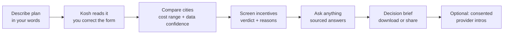

# Kosh UX

## Who it's for first

The executive at head office who sponsors a first India centre for a mid-market or PE-backed company (US$100M to 1B revenue), planning 20 to 150 seats, before an India head is hired. They have a budget owner to convince and no in-house India real estate, tax or HR team. Today they rely on referrals and on vendors who each quote different numbers.

Secondary users, later: setup providers (verified profiles, consented leads), state investment agencies (demand analytics), existing GCC leaders (benchmarks).

## The core flow

The first screen opens on a filled example plan, clearly labelled, so the product shows what it does before asking for anything.

## Information architecture

| Section | Job | Key element |
|---|---|---|
| Your plan | Capture the plan fast | Free-text "Read my plan" plus an editable form |
| Compare cities | See cost and certainty side by side | Range bars; a long bar means uncertain inputs |
| Incentives | Know what you can claim | Verdict chip with plain reasons per state |
| Ask Kosh | Any other question | Answers cite fact ids; "no verified figure" is allowed |
| Where sources disagree | Understand the confusion | Each version side by side with the reason for the gap |
| Providers | See who does what | Public claim vs Kosh-verified deliveries; alphabetical |
| Decision brief | Take it to the board | One page, every figure traceable |
| Sources | Audit everything | Interest-to-declare column |

## Design rules

- **The Source Dot.** Every number has a dot after it. Filled: sourced. Split: sources disagree. Hollow: single source, vendor or older than a year. Tap to see the source, its date, what it counts and whether the publisher sells GCC services.
- **Ranges, not false precision.** Costs show low to high. Where the data can't support a figure, the cell says so in words.
- **Status in words and shape, not colour alone.** Verdict chips carry text; dots differ in shape.
- **Calm surfaces.** Paper and ink, one vermilion action per screen, hairlines instead of shadows. The product should feel like a well-kept ledger, not a sales funnel.
- **Phone width.** Navigation becomes a scrolling tab row; tables scroll inside their own container; cost bars stack.

## States worth designing for

| State | What the user sees |
|---|---|
| Assistant unavailable or declined | The rest of the product works; Ask Kosh lists matching stored figures |
| City without data | "Not enough data to price. Kosh has no verified salary or rent figure for Kochi." |
| No policy | "No policy yet" chip and what to do instead |
| Answer would need outside data | "Kosh has no verified figure for that" and what kind of source would settle it |
| Intro request | Explicit per-provider choice; confirmation states exactly what was shared |

## Measuring it

- Activation: a plan with at least two cities compared in the first session.
- Value: briefs downloaded or shared per activated user.
- Trust: share of answers with zero dropped citations; source-drawer opens per session.
- Commercial (later): consented intro requests per brief; provider acceptance rate.
